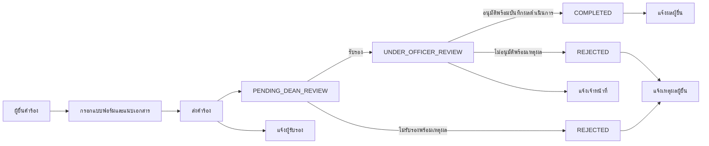
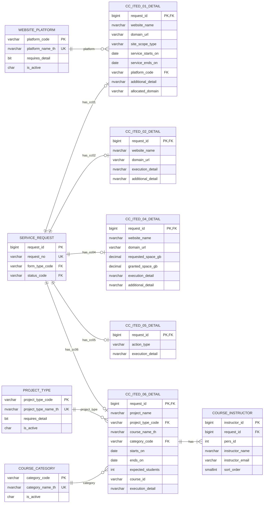

# Service Portal — ERD และ Workflow ปัจจุบัน

เอกสารนี้อธิบายโครงสร้างข้อมูลและลำดับการทำงานที่ใช้อยู่จริงใน schema `service_portal` ของฐานข้อมูล `academy_db1447` ตรวจสอบเทียบกับ migration, model, route และ `PortalController` ณ วันที่ 2 พฤศจิกายน 2569

Data Dictionary แบบรายละเอียดทุกคอลัมน์อยู่ที่ [service-request-data-dictionary-th.md](./service-request-data-dictionary-th.md)

## 1. Workflow ปัจจุบัน

ลำดับการทำงาน:

1. ผู้ยื่นเลือกแบบฟอร์ม `CC-ITED-01`, `02`, `04`, `05` หรือ `06` กรอกข้อมูล เลือกผู้รับรอง และแนบเอกสารเพิ่มเติมได้
2. เมื่อส่งคำร้อง ระบบสร้าง `service_request`, detail ตามชนิดแบบฟอร์ม, contact, document และประวัติสถานะ จากนั้นเปลี่ยนเป็น `PENDING_DEAN_REVIEW`
3. ระบบสร้าง `notification_outbox` ชนิด `DEAN_REVIEW_REQUIRED` เพื่อส่งลิงก์ลงนามดิจิทัลให้ผู้รับรองที่อยู่ในคำร้อง
4. ผู้รับรองรับรอง ระบบบันทึก `dean_review`, เปลี่ยนสถานะเป็น `UNDER_OFFICER_REVIEW` และแจ้งเจ้าหน้าที่ หรือไม่รับรอง ระบบเปลี่ยนเป็น `REJECTED` พร้อมแจ้งเหตุผลให้ผู้ยื่น
5. เจ้าหน้าที่ตรวจคำร้องและบันทึกผลตามแบบฟอร์มใน action เดียวกับการอนุมัติ ถ้าอนุมัติระบบบันทึก `officer_review`, กำหนด `completed_at`/`completed_by_pers_id`, เปลี่ยนเป็น `COMPLETED` และแจ้งผู้ยื่น ถ้าไม่อนุมัติจะเปลี่ยนเป็น `REJECTED` พร้อมแจ้งเหตุผล
6. ทุก transition เพิ่มแถวใน `request_status_history` และทุกอีเมลสร้างเป็น outbox ก่อนให้ worker ส่งภายหลัง
7. หลัง `COMPLETED` เจ้าหน้าที่แก้ไขผลดำเนินการได้ และเลือกส่ง `REQUEST_RESULT_UPDATED` เพื่อแจ้งผู้ยื่นได้

ไม่มีขั้น Approver, ไม่มีการอัปโหลดเอกสารที่นำไปเซ็นกลับเข้าระบบ และไม่มีการเก็บประวัติการดาวน์โหลด PDF

## 2. ERD — Core Workflow

เส้นทึบคือ Foreign Key จริง ส่วนความสัมพันธ์ `faculty_dean` ไป `service_request` เป็น logical lookup ผ่าน `target_dept_id` และ `dean_pers_id`; ตอนส่งคำร้องระบบ snapshot ตำแหน่งไว้ใน `dean_position_name`

```mermaid
erDiagram
    direction LR
    FORM_TYPE ||--o{ SERVICE_REQUEST : classifies
    REQUEST_STATUS ||--o{ SERVICE_REQUEST : current_status
    FACULTY_DEAN ||..o{ SERVICE_REQUEST : resolves_dean
    SERVICE_REQUEST ||--o{ REQUEST_CONTACT : has
    CONTACT_ROLE ||--o{ REQUEST_CONTACT : classifies
    SERVICE_REQUEST ||--o{ REQUEST_DOCUMENT : has
    DOCUMENT_TYPE ||--o{ REQUEST_DOCUMENT : classifies
    SERVICE_REQUEST ||--o{ DEAN_REVIEW : records
    SERVICE_REQUEST ||--o{ OFFICER_REVIEW : records
    SERVICE_REQUEST ||--o{ STATUS_HISTORY : audits
    REQUEST_STATUS ||--o{ STATUS_HISTORY : from_status
    REQUEST_STATUS ||--o{ STATUS_HISTORY : to_status
    SERVICE_REQUEST ||--o{ NOTIFICATION_OUTBOX : queues
    NOTIFICATION_TYPE ||--o{ NOTIFICATION_OUTBOX : classifies
    APP_ROLE ||--o{ USER_ROLE_ASSIGNMENT : grants
    FORM_TYPE ||--o{ FORM_NOTIFICATION_RECIPIENT : configures
    NOTIFICATION_TYPE ||--o{ FORM_NOTIFICATION_RECIPIENT : triggers
    APP_ROLE o|--o{ FORM_NOTIFICATION_RECIPIENT : targets

    FORM_TYPE {
        varchar form_type_code PK
        nvarchar form_name_th
        varchar route_name UK
        smallint current_version
        char is_active
    }
    REQUEST_STATUS {
        varchar status_code PK
        nvarchar status_name_th UK
        varchar badge_style
        bit is_terminal
        char is_active
    }
    FACULTY_DEAN {
        bigint faculty_dean_id PK
        int target_dept_id
        int dean_pers_id
        nvarchar position_name
        char is_active
    }
    SERVICE_REQUEST {
        bigint request_id PK
        varchar request_no UK
        varchar form_type_code FK
        int requester_pers_id
        int target_dept_id
        int dean_pers_id
        nvarchar dean_position_name
        varchar status_code FK
        datetime2 submitted_at
        datetime2 completed_at
        int completed_by_pers_id
    }
    CONTACT_ROLE {
        varchar contact_role_code PK
        nvarchar contact_role_name_th UK
        char is_active
    }
    REQUEST_CONTACT {
        bigint contact_id PK
        bigint request_id FK
        varchar contact_role_code FK
        int pers_id
        nvarchar full_name
        varchar email
        bit is_primary
    }
    DOCUMENT_TYPE {
        varchar document_type_code PK
        nvarchar document_type_name_th UK
        nvarchar allowed_mime_types
        bigint max_file_size_bytes
        char is_active
    }
    REQUEST_DOCUMENT {
        bigint document_id PK
        bigint request_id FK
        varchar document_type_code FK
        varchar storage_key UK
        int version_no
        int uploaded_by_pers_id
        datetime2 uploaded_at
    }
    DEAN_REVIEW {
        bigint dean_review_id PK
        bigint request_id FK
        int dean_pers_id
        varchar decision
        nvarchar comment
        datetime2 decided_at
    }
    OFFICER_REVIEW {
        bigint officer_review_id PK
        bigint request_id FK
        int officer_pers_id
        varchar decision
        nvarchar rejection_reason
        datetime2 reviewed_at
    }
    STATUS_HISTORY {
        bigint history_id PK
        bigint request_id FK
        varchar from_status_code FK
        varchar to_status_code FK
        int changed_by_pers_id
        varchar change_source
        datetime2 changed_at
    }
    NOTIFICATION_TYPE {
        varchar notification_type_code PK
        nvarchar notification_type_name_th UK
        varchar template_key UK
        char is_active
    }
    NOTIFICATION_OUTBOX {
        bigint notification_id PK
        bigint request_id FK
        varchar notification_type_code FK
        int recipient_pers_id
        varchar recipient_email
        varchar delivery_status
        int attempt_count
        datetime2 sent_at
    }
    APP_ROLE {
        smallint role_id PK
        varchar role_code UK
        nvarchar role_name_th
        char is_active
    }
    USER_ROLE_ASSIGNMENT {
        bigint role_assignment_id PK
        int pers_id
        smallint role_id FK
        char is_active
    }
    FORM_NOTIFICATION_RECIPIENT {
        bigint recipient_rule_id PK
        varchar form_type_code FK
        varchar notification_type_code FK
        varchar recipient_source
        smallint role_id FK
        int recipient_pers_id
        varchar recipient_email
        char is_active
    }
```

## 3. ERD — รายละเอียดแต่ละแบบฟอร์ม

คำร้องหนึ่งรายการต้องมี detail เพียงตารางเดียวตาม `form_type_code` ส่วน `request_contact` และ `request_document` เป็นข้อมูลกลางที่ทุกแบบฟอร์มใช้ร่วมกัน

## 4. ตารางหลักทำหน้าที่อะไร

| กลุ่ม | ตารางหลัก | หน้าที่ |
|---|---|---|
| Master | `form_type`, `request_status`, `contact_role`, `document_type`, `notification_type` | กำหนดชนิดฟอร์ม สถานะ บทบาทผู้ติดต่อ ประเภทเอกสาร และเหตุการณ์แจ้งเตือน |
| สิทธิ์และผู้รับรอง | `app_role`, `user_role_assignment`, `faculty_dean` | กำหนดสิทธิ์ USER/OFFICER และ mapping ผู้รับรองประจำส่วนงาน |
| Transaction กลาง | `service_request` | Header และสถานะปัจจุบันของทุกคำร้อง |
| ข้อมูลประกอบ | `request_contact`, `request_document` | Snapshot ผู้เกี่ยวข้องและ metadata ไฟล์ใน private storage |
| ผลตัดสิน | `dean_review`, `officer_review` | เก็บผลรับรองและผลตรวจของเจ้าหน้าที่แบบ append-only |
| Audit | `request_status_history` | ประวัติทุกการเปลี่ยนสถานะ |
| Notification | `form_notification_recipient`, `notification_outbox` | กฎผู้รับและคิวอีเมลที่ resolve แล้ว |
| Detail | `cc_ited_*_request_detail`, `course_instructor` | ข้อมูลเฉพาะของแต่ละแบบฟอร์มและรายชื่ออาจารย์ |

## 5. ข้อมูลจากภายนอก

คอลัมน์ `*_pers_id` และ `*_dept_id` เป็น Logical Reference ไป SWU MIS API ไม่ได้มี Foreign Key ใน SQL Server ข้อมูลชื่อ ตำแหน่ง อีเมล และส่วนงานจึงต้อง resolve ผ่าน API ก่อนบันทึก ส่วนข้อมูลที่ต้องคงตามวันที่ยื่น เช่น ชื่อผู้ติดต่อและตำแหน่งบริหารของผู้รับรอง จะถูกเก็บเป็น snapshot ในฐานข้อมูล

